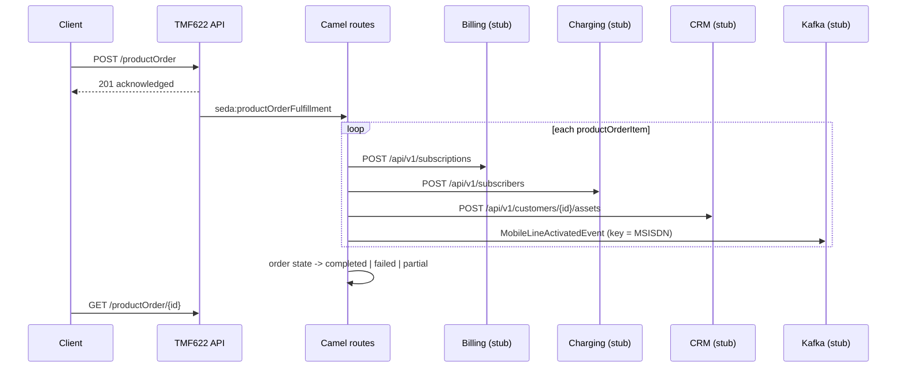

# Mobile Activation Service

Spring Boot service exposing the **TM Forum TMF622 Product Ordering API (v4)** to activate a mobile
number (MSISDN). Order fulfillment is orchestrated with **Apache Camel** and calls, in order:

1. **Billing** – create billing subscription (and billing account if none is supplied)
2. **Charging (OCS)** – provision the subscriber
3. **CRM** – register the mobile line as a customer asset
4. **Kafka** – publish a `MobileLineActivatedEvent`

All downstream systems are **stubbed** out of the box (embedded HTTP stubs + an in-memory Kafka stub),
so the service runs standalone.



## Run

Requires Java 17 and Maven.

```bash
mvn spring-boot:run
mvn test
```

## API

Base path: `/tmf-api/productOrderingManagement/v4`

| Method | Path | Description |
|--------|------|-------------|
| POST | `/productOrder` | Create an activation order (returns `201`, state `acknowledged`; fulfillment runs asynchronously) |
| GET | `/productOrder?state=completed` | List orders, optionally filtered by state |
| GET | `/productOrder/{id}` | Retrieve an order (state, item states, `note` audit trail, `errorMessage`) |

```bash
curl -i -X POST localhost:8080/tmf-api/productOrderingManagement/v4/productOrder \
  -H 'Content-Type: application/json' -d @examples/activate-mobile-line.json

curl localhost:8080/tmf-api/productOrderingManagement/v4/productOrder/<id>
```

### Order requirements

- `relatedParty` entry with `role: Customer` and an `id`
- each `productOrderItem`: `action: add`, `productOffering.id` (tariff plan), and `product.productCharacteristic`
  containing `MSISDN` (E.164, optional leading `+`) and `ICCID` (19-20 digits)

Invalid orders are rejected with `400` and a TMF `Error` body.

### Order lifecycle

`acknowledged` → `inProgress` → `completed`, or on failure:
- `failed` – no item was activated
- `partial` – earlier items were activated, a later one failed (remaining items are `cancelled`)

Transient errors (I/O errors, HTTP 5xx) are retried per step (`integration.retry.*`, default 2 retries);
4xx responses are not retried. Each completed/failed step is recorded as a `note` on the order.

## Stubs

| Endpoint | Purpose |
|----------|---------|
| `POST /stubs/billing/api/v1/subscriptions` | Billing stub |
| `POST /stubs/charging/api/v1/subscribers` | Charging stub |
| `POST /stubs/crm/api/v1/customers/{customerId}/assets` | CRM stub |
| `GET /stubs/invocations` | Calls received by the stubs (in order) |
| `GET /stubs/kafka/events` | Events published to the Kafka stub |
| `DELETE /stubs` | Reset recorded calls/events |

Simulated outages (configured under `stubs.failing-msisdns`):

| MSISDN | Failing system |
|--------|----------------|
| `201000000001` | Billing (503) |
| `201000000002` | Charging (503) |
| `201000000003` | CRM (503) |
| `201000000004` | Kafka |

## Configuration

| Property / env var | Default |
|--------------------|---------|
| `BILLING_URL` | `http://localhost:${server.port}/stubs/billing` |
| `CHARGING_URL` | `http://localhost:${server.port}/stubs/charging` |
| `CRM_URL` | `http://localhost:${server.port}/stubs/crm` |
| `KAFKA_TOPIC` | `telecom.mobile-line.activated` |
| `KAFKA_BROKERS` | `localhost:9092` |
| `STUBS_ENABLED` | `true` (set `false` together with real URLs and the `kafka` profile) |

### Real Kafka

```bash
docker compose up -d
SPRING_PROFILES_ACTIVE=kafka mvn spring-boot:run
```

The `kafka` profile switches `integration.kafka.endpoint` from the in-memory stub to
`kafka:${KAFKA_TOPIC}?brokers=${KAFKA_BROKERS}`.

## Notes

- Orders are stored in memory; replace `ProductOrderRepository` with a persistent store for production.
- No compensation (rollback) is performed for steps that succeeded before a failure.
